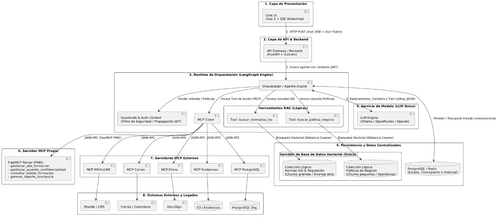
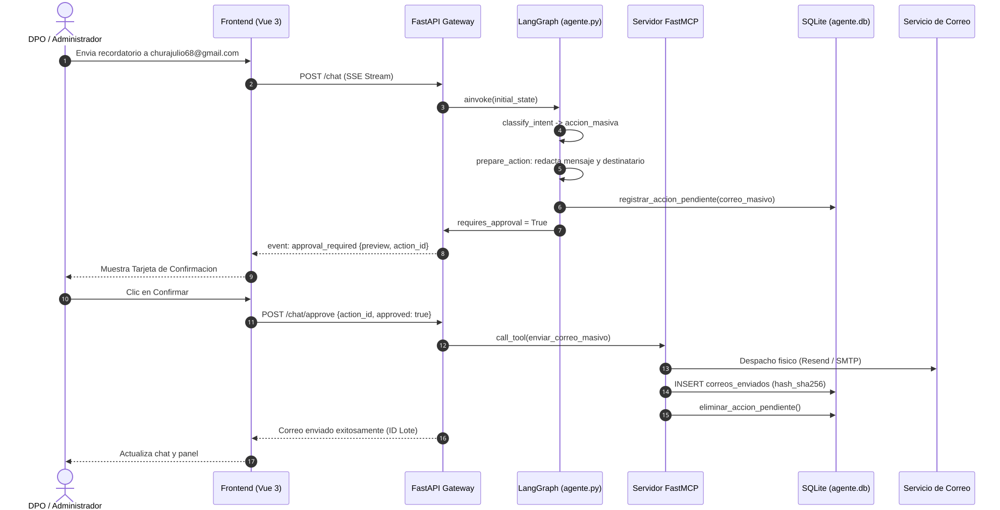
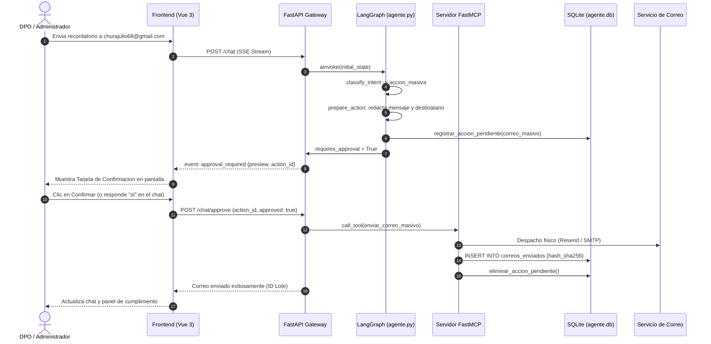

# Agente de Formación y Conciencia — PIMS UNSA (Agente #8)


| Metadato | Detalle |
| :--- | :--- |
| **Proyecto** | Sistema Multiagente para PIMS (Privacy Information Management System) |
| **Institución** | Universidad Nacional de San Agustín de Arequipa (UNSA) |
| **Agente Asignado** | **Agente #8: Formación y Conciencia** |
| **Estándares Cubiertos** | **ISO/IEC 27701:2025** (Controles A.3.17 y A.3.18, Cláusulas 7.2, 7.3, 7.4) |
| **Marco Legal** | **Ley N° 29733** (Protección de Datos Personales de Perú) y **D.S. 003-2013-JUS** |

---

## Índice

1. [Introducción](#1-introducción)
2. [Estado del Avance](#2-estado-del-avance)
3. [Arquitectura del Sistema](#3-arquitectura-del-sistema)
4. [Tecnologías Utilizadas](#4-tecnologías-utilizadas)
5. [Guía de Instalación y Ejecución](#5-guía-de-instalación-y-ejecución)
6. [Estructura del Proyecto](#6-estructura-del-proyecto)
7. [Componentes Técnicos del Agente](#7-componentes-técnicos-del-agente)
8. [Cumplimiento Normativo (ISO 27701 y Ley 29733)](#8-cumplimiento-normativo-iso-27701-y-ley-29733)
9. [Usuarios de Prueba Precargados](#9-usuarios-de-prueba-precargados)
10. [Escenarios de Prueba y Demostración](#10-escenarios-de-prueba-y-demostración)
11. [Trabajo Futuro](#11-trabajo-futuro)

---

## 1. Introducción

El presente proyecto documenta el diseño, desarrollo e implementación del **Agente #8: Formación y Conciencia**, componente nuclear de la arquitectura multiagente del **Privacy Information Management System (PIMS)** de la **Universidad Nacional de San Agustín de Arequipa (UNSA)**.

El objetivo central del agente es actuar como **copiloto inteligente y supervisor automatizado del Oficial de Protección de Datos (DPO)** y de la comunidad universitaria (docentes, administrativos y jefaturas), asegurando el cumplimiento estricto de:
* **Control ISO/IEC 27701:2025 A.3.17:** Formación continua, concienciación y evaluación de competencias en privacidad de la información.
* **Control ISO/IEC 27701:2025 A.3.18:** Gestión, suscripción, seguimiento y renovación de Acuerdos de Confidencialidad y Secreto Profesional (NDAs).
* **Ley N° 29733 (Perú) y D.S. 003-2013-JUS:** Garantía del principio de seguridad, consentimiento informado y deber de secreto profesional en el ámbito universitario público.

El agente no es un simple bot conversacional; es un **agente autónomo estructurado en LangGraph** con recuperación aumentada por generación (**RAG**), herramientas expuestas vía **Model Context Protocol (FastMCP)**, persistencia transaccional y auditable en **SQLite con hashes SHA-256**, soporte para **Human-in-the-Loop (HITL)** para acciones críticas y streaming en tiempo real vía **Server-Sent Events (SSE)**.

---

## 2. Estado del Avance

| Componente | Estado | Detalle de Implementación |
| :--- | :---: | :--- |
| **Grafo LangGraph (9 Nodos)** | Implementado | Flujo cíclico con estados tipados (`PIMSState`), enrutamiento condicional y memoria en sesión (`MemorySaver`). |
| **RAG Semántico (ChromaDB)** | Implementado | 2 colecciones físicas (`normas_iso` y `politicas_negocio`) con embeddings multilingües y citas normativas. |
| **Human-in-the-Loop (HITL)** | Implementado | Doble confirmación: botón interactivo en UI (`/chat/approve`) o confirmación semántica por lenguaje natural libre (*"sí"*, *"confirmo"*, *"procede"*). |
| **Servidor FastMCP Propio** | Implementado | 6 herramientas operativas (`gestionar_alta_formacion`, `gestionar_acuerdo_confidencialidad`, `consultar_estado_formacion`, `generar_reporte_conciencia`, `listar_usuarios`, `enviar_correo_masivo`). |
| **Despacho Físico de Correos** | Implementado | Integración con **Resend API** y **SMTP Gmail**, con registro auditable y hash SHA-256 en SQLite (`correos_enviados`). |
| **Sistemas Legados (Mock Persistente)** | Implementado | Moodle UNSA (`matriculas_lms_mock`), Firma Digital (`firmas_mock`), Evidencias PDF (`./evidencias/`) y PII (`audit_log`). |
| **API Gateway (FastAPI)** | Implementado | Autenticación JWT HS256 (8 horas), streaming SSE token a token, endpoints de auditoría, dashboard y chat. |
| **Frontend Web (Vue 3 + Vite)** | Implementado | SPA moderna con Pinia, Vue Router, renderizado seguro de Markdown (`marked` + `DOMPurify`), panel de estado y tarjetas de aprobación. |
| **Base de Datos SQLite** | Implementado | 12 tablas relacionales con claves foráneas, auditoría inmutable y 17 usuarios precargados. |
| **Integración con Orquestador Global** | En Progreso | El servidor FastMCP está listo para ser consumido por el orquestador principal del PIMS multiagente. |

---

## 3. Arquitectura del Sistema

El agente se organiza en una arquitectura desacoplada de 8 capas funcionales:



<details>
<summary><b>Ver mapa esquemático de las 8 capas</b></summary>

```text
+---------------------------------------------------------------------------------------+
| 1. Capa de Presentación: SPA Vue 3 + Pinia + Vue Router + Vite + SSE Streaming        |
|    - Chat en tiempo real, renderizado Markdown, panel de métricas y tarjetas HITL     |
+---------------------------------------------------------------------------------------+
| 2. Capa de API Gateway: FastAPI + Uvicorn + Seguridad JWT (HS256)                      |
|    - Endpoints REST (/auth/login, /dashboard/estado, /chat, /chat/approve)             |
+---------------------------------------------------------------------------------------+
| 3. Runtime del Agente: LangGraph Engine (Grafo de 9 Nodos + MemorySaver)             |
|    - entry -> classify_intent -> rag_search / tool_call / prepare_action -> response  |
+---------------------------------------------------------------------------------------+
| 4. Capa de Inferencia LLM: LLMService Multi-Proveedor                                 |
|    - OpenRouter (Nvidia Nemotron, Llama 3.3, Mistral) u Ollama Local (Llama 3.2)      |
+---------------------------------------------------------------------------------------+
| 5. Capa de Persistencia: SQLite (agente.db) + Base Vectorial ChromaDB                 |
|    - 12 tablas SQLite relacionales + colecciones vectoriales normas_iso y politicas   |
+---------------------------------------------------------------------------------------+
| 6. Servidor MCP Propio: FastMCP Server                                                |
|    - 6 Herramientas de dominio formativo y gobernanza expuestas por protocolo MCP      |
+---------------------------------------------------------------------------------------+
| 7. Clientes MCP Externos (Mock Persistente):                                         |
|    - MCP Correo (Resend/SMTP), MCP LMS (Moodle), MCP Firma (NDAs), MCP Evidencias     |
+---------------------------------------------------------------------------------------+
| 8. Sistemas Legados Institucionales:                                                  |
|    - Base de Datos de Personal UNSA, Bandejas de Correo y Repositorio de Certificados |
+---------------------------------------------------------------------------------------+
```

</details>

### 3.1 Flujo de Ejecución con Aprobación Humana (HITL)



<details>
<summary><b>Ver código fuente del diagrama de secuencia (Mermaid)</b></summary>



</details>

---

## 4. Tecnologías Utilizadas

| Capa / Módulo | Tecnología | Versión | Rol en el Proyecto |
| :--- | :--- | :--- | :--- |
| **Backend Runtime** | Python | `3.10+` (probado en 3.12) | Lenguaje base del servidor y lógica del agente |
| **Framework Web API** | FastAPI | `0.115+` | API REST asíncrona, inyección de dependencias y SSE |
| **Servidor ASGI** | Uvicorn | `0.30+` | Servidor ASGI de alto rendimiento con hot-reload |
| **Orquestación de Agente** | LangGraph | `1.2+` | Modelado del flujo de decisión en grafo cíclico y estados |
| **Abstracción de Mensajes** | LangChain Core | `0.3+` | Esquemas de mensajes (`HumanMessage`, `AIMessage`, etc.) |
| **Base Vectorial (RAG)** | ChromaDB | `0.5+` | Indexación persistente y búsqueda semántica por similitud |
| **Embeddings** | HuggingFace / Ollama | `multilingual-e5` / `nomic` | Vectorización densa multilingüe de normativas y leyes |
| **LLM en la Nube** | OpenRouter API | API v1 | Inferencia cloud con modelos de vanguardia (Nemotron, Llama) |
| **LLM Local (Opcional)** | Ollama | `latest` | Inferencia privada local desconectada (`llama3.2:3b`) |
| **Protocolo de Herramientas**| FastMCP | `0.4+` | Servidor y cliente del Model Context Protocol (Anthropic) |
| **Base de Datos Relacional** | SQLite | `3.x` | Persistencia transaccional local (`agente.db`) |
| **Seguridad y Tokens** | Python-Jose + Passlib | `3.3+` / `1.7+` | Generación de JWT (HS256) y hashing seguro con BCrypt |
| **Despacho de Correos** | Resend API + SMTPLib | HTTP / TLS | Despacho de correos transaccionales a bandejas reales |
| **Frontend Framework** | Vue 3 | `3.4+` | Interfaz reactiva en arquitectura SPA (Single Page Application)|
| **Build Tooling** | Vite | `5.4+` | Entorno de desarrollo ultrarrápido y servidor proxy |
| **Gestor de Estado** | Pinia | `2.1+` | Gestión del estado global (sesión, chat, métricas) |
| **Enrutamiento** | Vue Router | `4.3+` | Navegación entre vistas (`/login` y `/chat`) |
| **Renderizado Markdown** | Marked + DOMPurify | `latest` | Parseo dinámico y sanitización contra ataques XSS |

---

## 5. Guía de Instalación y Ejecución

Sigue estos pasos detallados para levantar el entorno completo en tu máquina local (**Windows**, **Linux** o **macOS**).

### 5.1 Requisitos Previos

* **Python 3.10 o superior** instalado y agregado al `PATH`.
* **Node.js 18 o superior** y **npm** instalados.
* Git instalado.
* *(Opcional)* Cuenta gratuita en [OpenRouter](https://openrouter.ai/) o [Ollama](https://ollama.com/) instalado localmente.
* *(Opcional)* Cuenta en [Resend](https://resend.com/) o cuenta de Gmail para pruebas de correo real.

---

### 5.2 Configuración del Backend

#### 1. Clonar el repositorio y acceder a la carpeta backend:
```bash
git clone <URL_DEL_REPOSITORIO>
cd agente-unsa/backend
```

#### 2. Crear y activar el entorno virtual:
* **En Windows (PowerShell):**
  ```powershell
  python -m venv venv
  .\venv\Scripts\activate
  ```
* **En Linux / macOS:**
  ```bash
  python3 -m venv venv
  source venv/bin/activate
  ```

#### 3. Instalar las dependencias de Python:
```bash
pip install --upgrade pip
pip install -r requirements.txt
pip install chromadb sentence-transformers
```

#### 4. Configurar las variables de entorno (`.env`):
Copia la plantilla de entorno:
```bash
# En Windows:
copy .env.example .env

# En Linux / macOS:
cp .env.example .env
```

Abre el archivo `.env` en tu editor y configura tus parámetros. Ejemplo funcional:
```env
# Seguridad y JWT
JWT_SECRET=unsa_pims_secret_key_demo_2025_academico
JWT_ALGORITHM=HS256
JWT_EXPIRATION_HOURS=8

# Proveedor de LLM (openrouter u ollama)
LLM_PROVIDER=openrouter
OPENROUTER_API_KEY=tu_api_key_de_openrouter_aqui
OPENROUTER_MODEL=nvidia/nemotron-3.5-lightning:free
OPENROUTER_BASE_URL=https://openrouter.ai/api/v1

# Configuración Ollama (Opcional si usas proveedor local)
OLLAMA_HOST=http://localhost:11434
OLLAMA_MODEL=llama3.2
OLLAMA_EMBED_MODEL=nomic-embed-text

# Rutas de Persistencia
DB_PATH=agente.db
CHROMA_PATH=./chroma_db
EVIDENCIAS_PATH=./evidencias

# Despacho Real de Correos
RESEND_API_KEY=re_tu_clave_resend_aqui
SMTP_HOST=smtp.gmail.com
SMTP_PORT=587
SMTP_USER=tu_correo@gmail.com
SMTP_PASSWORD=tu_contraseña_de_aplicacion_google
SMTP_FROM_EMAIL=jchuraaca@unsa.edu.pe
```

#### 5. Inicializar la Base de Datos SQLite (Semilla de usuarios y cursos):
Este comando crea las 12 tablas en `agente.db` e inserta los usuarios de prueba, asignaciones formativas y estados de NDAs:
```bash
python init_db.py
```
> *Salida esperada:* `Base de datos inicializada con éxito en agente.db`

#### 6. Ingestar e Indexar la Base de Conocimiento en ChromaDB (RAG):
Indexa las normativas ISO 27701:2025, la Ley N° 29733, el D.S. 003-2013-JUS y las políticas de privacidad de la UNSA:
```bash
python ingesta.py
```
> *Salida esperada:* `Ingesta RAG completada con éxito.`

#### 7. Iniciar el servidor Backend (FastAPI + Uvicorn):
```bash
uvicorn main:app --reload --port 8000
```
El backend quedará escuchando en:
* **API Gateway:** `http://127.0.0.1:8000`
* **Documentación interactiva Swagger UI:** `http://127.0.0.1:8000/docs`

---

### 5.3 Configuración del Frontend

En una **segunda terminal**, dirígete a la carpeta `frontend/`:

#### 1. Acceder al directorio e instalar dependencias Node:
```bash
cd ../frontend
npm install
```

#### 2. Iniciar el servidor de desarrollo Vite:
```bash
npm run dev
```

El servidor Vite levantará en:
* **Aplicación Web:** `http://localhost:5173`

*(Vite está preconfigurado en `vite.config.js` con un proxy reverso que redirige automáticamente todas las peticiones `/auth`, `/chat` y `/dashboard` hacia `http://127.0.0.1:8000`).*

---

## 6. Estructura del Proyecto

```text
agente-unsa/
├── backend/
│   ├── .env                      # Variables de entorno locales
│   ├── .env.example              # Plantilla de variables de entorno
│   ├── requirements.txt          # Dependencias Python del backend
│   ├── config.py                 # Carga y validación de variables de configuración
│   ├── db.py                     # Conexión SQLite, esquema de 12 tablas y auditoría
│   ├── init_db.py                # Script semilla para poblar usuarios y cursos sintéticos
│   ├── auth.py                   # Lógica de contraseñas BCrypt y tokens JWT
│   ├── main.py                   # API FastAPI, endpoints REST y canal SSE
│   ├── state.py                  # Definición del estado tipado LangGraph (PIMSState)
│   ├── prompts.py                # System Prompts, Guardrails y plantillas de intención
│   ├── agente.py                 # Grafo LangGraph de 9 nodos con MemorySaver
│   ├── llm_service.py            # Factoría de clientes LLM (OpenRouter / Ollama)
│   ├── rag.py                    # Búsqueda semántica en colecciones ChromaDB
│   ├── ingesta.py                # Script de indexación y chunking de normativas
│   ├── mcp_client.py             # Cliente despachador hacia FastMCP y MCPs externos
│   ├── mcp_server.py             # Servidor FastMCP local (expone las 6 herramientas)
│   ├── actions.py                # Preparación, registro y ejecución física de acciones
│   ├── agente.db                 # Base de datos SQLite operativa
│   ├── chroma_db/                # Directorio persistente de ChromaDB (vector store)
│   ├── evidencias/               # Almacenamiento local de certificados y evidencias PDF
│   └── mcp_externos/             # Simuladores mock persistentes en SQLite
│       ├── correo_mock.py        # Despacho físico (Resend / SMTP) y hash SHA-256
│       ├── lms_mock.py           # Matrículas simuladas Moodle UNSA
│       ├── firma_mock.py         # Solicitudes de firma electrónica simuladas
│       ├── evidencias_mock.py    # Generación y almacenamiento de evidencias
│       └── postgres_mock.py      # Consulta de logs PII y auditoría
├── frontend/
│   ├── package.json              # Configuración de dependencias Node
│   ├── vite.config.js            # Configuración de Vite y proxy HTTP hacia backend
│   ├── index.html                # Entrada principal HTML5
│   └── src/
│       ├── main.js               # Inicialización de Vue 3, Pinia y Router
│       ├── App.vue               # Componente raíz
│       ├── api.js                # Cliente HTTP y consumidor de streams SSE
│       ├── router/
│       │   └── index.js          # Rutas y guardias de navegación por JWT
│       ├── stores/
│       │   ├── auth.js           # Estado de autenticación y rol del usuario
│       │   └── chat.js           # Historial reactivo, streaming y aprobación HITL
│       ├── views/
│       │   ├── LoginView.vue     # Pantalla de acceso institucional
│       │   └── ChatView.vue      # Vista principal del chat con sidebar y panel
│       └── components/
│           ├── ChatMessage.vue   # Renderizado de mensajes con soporte Markdown
│           ├── PanelEstado.vue   # Widget lateral de métricas de cumplimiento
│           ├── Sidebar.vue       # Barra lateral de conversaciones e historial
│           └── TarjetaConfirmacion.vue # Tarjeta interactiva de aprobación humana
├── knowledge_base/               # Documentos normativos semilla (ISO, Ley, UNSA)
│   ├── normas/                   # Resúmenes de ISO/IEC 27701:2025
│   ├── normativas/               # Ley 29733 y D.S. 003-2013-JUS
│   ├── politicas/                # Políticas de Privacidad y Seguridad UNSA
│   ├── plantillas/               # Modelos de Acuerdos de Confidencialidad (NDAs)
│   └── faq/                      # Preguntas frecuentes de la comunidad universitaria
└── README.md                     # Documentación técnica completa
```

---

## 7. Componentes Técnicos del Agente

### 7.1 Grafo LangGraph de 9 Nodos



El núcleo del agente en `agente.py` implementa una máquina de estados mediante `StateGraph(PIMSState)` con los siguientes 9 nodos:

1. **`entry`**: Inicializa el estado, valida identidad y rol desde el token JWT.
2. **`classify_intent`**: Clasifica la consulta mediante LLM estructurado en intenciones: `consulta_estado`, `consulta_normativa`, `consulta_usuarios`, `accion_individual`, `accion_masiva` o `fuera_de_alcance`.
3. **`rag_search`**: Recupera fragmentos de normativas desde ChromaDB.
4. **`tool_call`**: Invoca herramientas de lectura no destructivas a través del `MCPClient`.
5. **`prepare_action`**: Extrae semánticamente parámetros (destinatarios, asuntos, fechas) y registra la acción en la tabla `acciones_pendientes`.
6. **`human_approval`**: Punto de control de supervisión humana (HITL).
7. **`execute_action`**: Ejecuta físicamente la acción tras la aprobación del usuario.
8. **`generate_response`**: Sintetiza la respuesta final en Markdown enriquecido con citas normativas.
9. **`derive_response`**: Responde con empatía y cortesía institucional a preguntas fuera de alcance, reorientando hacia la privacidad.

### 7.2 Human-in-the-Loop (HITL) Formal

Para dar cumplimiento a los controles **A.3.17 y A.3.18**, las acciones de escritura externa (como enviar correos masivos o matricular en cursos) **nunca se ejecutan automáticamente**. El sistema implementa un flujo dual:
1. **Vía Interfaz Gráfica:** Se emite el evento SSE `approval_required`. El frontend despliega la `TarjetaConfirmacion.vue` con la vista previa detallada (destinatarios, asunto, cuerpo) y botones interactivos **Confirmar** y **Cancelar** que invocan `POST /chat/approve`.
2. **Vía Conversacional Libre:** Si el usuario no presiona el botón y en su lugar escribe en el chat: *"Sí"*, *"adelante"*, *"confirmo"*, *"procede"* o *"cancela"*, el evaluador semántico `check_approval_semantic()` detecta la confirmación y ejecuta la acción correspondiente.

### 7.3 Servidor FastMCP Propio (`backend/mcp_server.py`)

Expone 6 herramientas listas para su integración por el orquestador global:
* `gestionar_alta_formacion(user_id, formacion_id)`: Matricula al usuario en LMS Moodle.
* `gestionar_acuerdo_confidencialidad(user_id, tipo, accion)`: Gestiona y firma NDAs institucionales.
* `consultar_estado_formacion(user_id)`: Retorna cursos completados, pendientes, vencidos y NDAs.
* `generar_reporte_conciencia(facultad)`: Retorna tasas de cumplimiento y métricas consolidadas.
* `listar_usuarios(filtros, solicitante_rol)`: Consulta usuarios aplicando control de acceso basado en roles (RBAC).
* `enviar_correo_masivo(user_ids, asunto, cuerpo)`: Envía correos físicos o registrados a una lista de usuarios o correos directos.

---

## 8. Cumplimiento Normativo (ISO 27701 y Ley 29733)

| Control / Cláusula | Marco Legal / Estándar | Cómo lo Implementa el Agente |
| :--- | :--- | :--- |
| **Control A.3.17** | ISO/IEC 27701:2025 | Detección de brechas formativas, convocatorias por correo, recordatorios y métricas por facultad. |
| **Control A.3.18** | ISO/IEC 27701:2025 | Gestión de NDAs para docentes, administrativos y personal externo con fecha de vencimiento anual. |
| **Cláusula 7.2** | ISO/IEC 27701:2025 | Verificación de competencia mediante registro inmutable de certificados y cursos aprobados. |
| **Cláusula 7.3** | ISO/IEC 27701:2025 | RAG informativo para que cualquier miembro de la UNSA consulte sus deberes de privacidad. |
| **Cláusula 7.4** | ISO/IEC 27701:2025 | Generación de reportes de concienciación y canales de comunicación auditados. |
| **Principio de Seguridad** | Ley N° 29733 Art. 19 | Medidas organizativas para garantizar que solo personal capacitado trate datos personales. |
| **Deber de Secreto** | Ley N° 29733 Art. 17 | Suscripción de acuerdos de secreto profesional documentados en `firmas_mock` y `acuerdos_confidencialidad`. |
| **Capacitación Continua** | D.S. 003-2013-JUS Art. 38 | Programa periódico de inducción y refresco para nuevos ingresantes (< 30 días). |

---

## 9. Usuarios de Prueba Precargados

La base de datos contiene los siguientes usuarios sintéticos con contraseñas hasheadas en **BCrypt**:

| Usuario / Login | Contraseña | Rol | Dependencia / Facultad | Escenario de Prueba |
| :--- | :--- | :--- | :--- | :--- |
| `admin` | `admin` | `admin` | Rectorado / Sistemas | Acceso total, envío masivo y gestión global |
| `maria.lopez` | `maria123` | `jefe` | Ingeniería / Sistemas | Gestión de cumplimiento de su facultad |
| `juan.perez` | `juan123` | `docente` | Ingeniería / Sistemas | Usuario antiguo con cursos y NDAs vencidos |
| `ana.gomez` | `ana123` | `docente` | Medicina / Clínicas | Usuario con formación al día |
| `lucia.torres` | `lucia123` | `docente` | Derecho / Privado | Consulta de normativas legales |
| `carlos.ruiz` | `carlos123` | `administrativo`| Administración Central | Personal con acceso a datos sensibles |
| `elena.vargas` | `elena123` | `auditor` | Control Interno / OCI | Modo solo lectura para auditorías PIMS |
| `nuevo1` | `nuevo1` | `docente` | Ingeniería (< 30 días) | Ingresante nuevo sin formación ni NDA |
| `nuevo2` | `nuevo2` | `docente` | Medicina (< 30 días) | Ingresante nuevo sin formación ni NDA |
| `nuevo3` | `nuevo3` | `administrativo`| RRHH (< 30 días) | Ingresante nuevo sin formación ni NDA |
| `nuevo4` | `nuevo4` | `administrativo`| Biblioteca (< 30 días) | Ingresante nuevo sin formación ni NDA |
| `nuevo5` | `nuevo5` | `docente` | Derecho (< 30 días) | Ingresante nuevo sin formación ni NDA |
| `juliochura68` | `hash_pass` | `admin` | Ingeniería / Sistemas | Cuenta verificada para pruebas de correo |
| `churajulio68` | `hash_pass` | `docente` | Ingeniería / Sistemas | Cuenta registrada en la base de datos |

---

## 10. Escenarios de Prueba y Demostración

### Caso 1: Consulta Personal de Cumplimiento (Docente)
1. Inicia sesión con `juan.perez` / `juan123`.
2. Escribe: *"¿Qué cursos de privacidad tengo pendientes?"*
3. **Resultado:** El agente consulta `consultar_estado_formacion`, cita el **Control A.3.17** y la **Ley 29733**, e indica que tiene el curso *Protección de Datos Personales* vencido y el NDA pendiente de firma.

### Caso 2: Auditoría de Nuevos Ingresos (Admin)
1. Inicia sesión con `admin` / `admin`.
2. Escribe: *"¿Quiénes son los usuarios nuevos ingresados recientemente?"*
3. **Resultado:** Invoca `listar_usuarios(antiguedad_dias=30)` y lista a los 5 nuevos trabajadores (`nuevo1` a `nuevo5`), señalando que requieren inducción obligatoria antes de tratar datos institucionales.

### Caso 3: Envío de Correo Masivo con Aprobación Humana (HITL)
1. Como `admin`, escribe: *"Envíales un correo de convocatoria a los nuevos para la capacitación del lunes a las 10:00 am"*
2. **Resultado:** 
   - El nodo `prepare_action` extrae los 5 correos, fecha y hora.
   - Aparece la **Tarjeta de Confirmación** con la vista previa.
   - Al pulsar **Confirmar** (o responder *"sí"* en el chat), se realiza el despacho a través de `enviar_correo_masivo`, guardando cada mensaje en SQLite con su hash criptográfico SHA-256.

### Caso 4: Consulta Fuera de Alcance (Guardrail de Dominio)
1. Escribe: *"¿A qué hora abre el comedor universitario?"*
2. **Resultado:** El nodo `derive_response` responde amablemente con información sobre los canales generales de la universidad y recuerda con cortesía que su función se centra en la privacidad de datos (Ley 29733 e ISO 27701).

---

## 11. Trabajo Futuro

* **Conexión con el Orquestador Global del PIMS:** Integrar las 6 herramientas FastMCP en la red multiagente institucional (junto con Agente de Inventario, Agente de Riesgos y Agente de Brechas).
* **Conectores Reales de Producción:** Sustituir los simuladores mock por integraciones directas con Moodle REST API de la UNSA y DocuSign / FirmaPerú.
* **Dominio Institucional en Resend / Servidor de Correo Propio:** Registrar el dominio `@unsa.edu.pe` en Resend o habilitar credenciales de correo institucional en el archivo `.env` para envíos irrestrictos a cualquier cuenta.
* **Despliegue Contenerizado:** Creación de `Dockerfile` y `docker-compose.yml` para despliegue automatizado en servidores del Rectorado UNSA.

---

**Oficina de Protección de Datos y Privacidad de la Información (PIMS) — Universidad Nacional de San Agustín de Arequipa (UNSA)**